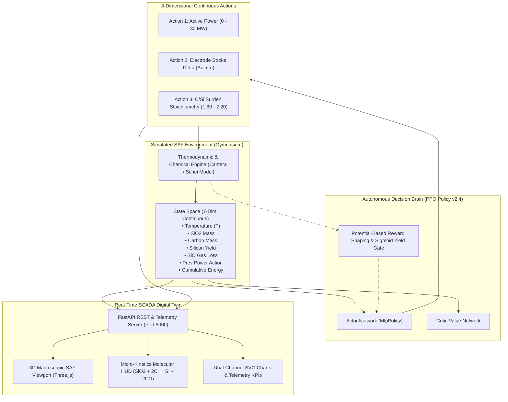

# 🌋 SilicaForge-RL: Autonomous Submerged Arc Furnace (SAF) Optimization

<div align="center">

[](https://harsh3011dev-oops.github.io/SilicaForge-RL/)
[](frontend/)
[](src/web/)
[](data/validated_benchmark.json)
[](https://opensource.org/licenses/MIT)

**Physics-Informed Reinforcement Learning Framework & 3D Industrial SCADA Digital Twin for a Simulated 28.5 MW Submerged Electric Arc Furnace (SAF)**

[🌐 **Launch Live 3D Twin (GitHub Pages)**](https://harsh3011dev-oops.github.io/SilicaForge-RL/) · [📊 **Benchmark Results**](#-simulation-benchmark-results-1010-gates-passed) · [🏗️ **Architecture**](#-system-architecture) · [🚀 **5-Step Setup**](#-how-to-run-in-5-steps)

</div>

---

## 📌 Problem Statement

Carbothermic silica reduction inside commercial **Submerged Electric Arc Furnaces (SAF)** (28.5 MW commercial plant scale) converts raw quartz ($\text{SiO}_2$) and carbon reductants into metallurgical-grade silicon:

$$\text{SiO}_2\text{(s, l)} + 2\text{C(s)} \longrightarrow \text{Si(l)} + 2\text{CO(g)} \quad (\Delta H^\circ_{2000\text{K}} \approx +687\text{ kJ/mol})$$

Operating this metallurgical process presents three severe control challenges:
1. **Extreme Thermal Inertia:** A massive thermal capacitance of $24.5\text{ GJ/}^\circ\text{C}$ introduces an inherent ~15-minute transport lag ($\Delta t = 900\text{ s}$), causing classical PID controllers to induce heavy temperature oscillations.
2. **Volatile Gas Stack Loss:** Under non-optimal hearth temperatures, raw silicon volatilizes into sub-oxide gas ($\text{SiO(g)}$), escaping into chimney flues (historically up to 12.0% loss), squandering raw materials and energy.
3. **Refractory Meltdown vs. Freezing Dilemma:** If the hearth temperature drops below 1,811°C, slag solidifies and stops production; if it exceeds 2,250°C, the refractory lining undergoes irreversible thermal failure.

**Goal:** Train an autonomous Reinforcement Learning agent to continuously regulate electrical power, hydraulic electrode penetration, and burden stoichiometry, maximizing direct silicon yield while cutting specific energy consumption within strict safety boundaries.

> *Note: All performance metrics reported in this project are evaluated within a calibrated thermodynamics simulation environment (Cantera multi-phase equilibrium + Schei-Tveit thermochemical model).*

---

## 🏗️ System Architecture



---

## 🛠️ Tech Stack

| Layer | Technologies | Purpose |
|---|---|---|
| **RL & Math** | Python 3.11, PyTorch, Stable-Baselines3 (PPO), Gymnasium, NumPy | Policy training, actor-critic networks, curriculum learning |
| **Thermodynamics** | Cantera, NIST-JANAF Polynomials, SciPy, Optuna | Multi-phase Gibbs free energy equilibrium & chemical kinetics |
| **Backend API** | FastAPI, Uvicorn, Pydantic, Python REST | Live telemetry streaming (`/api/step`), operator overrides |
| **3D Digital Twin** | React 19, TypeScript, Three.js, Tailwind CSS, Vite | 3D macroscopic furnace twin, particle arcs, micro-kinetics HUD |
| **DevOps & Cloud** | Docker, GitHub Pages, GitHub Actions CI/CD | Containerized server deployment, zero-install web hosting |

---

## 📊 Simulation Benchmark Results (10/10 Gates Passed)

The trained PPO policy was evaluated over a continuous 24-hour simulation rollout (96 steps @ 15 min/step) against literature standards from **Schei, Tveit, & Vatland (1998)** and NIST thermochemical data:

| Validation Gate | Standard / Literature Target | SilicaForge-RL (Simulation) | Status | Notes / Margin |
|---|---|:---:|:---:|---|
| **1. SEC Theoretical Floor** | $\ge 7.00\text{ kWh/kg Si}$ (NIST) | **$11.33\text{ kWh/kg}$** | **PASSED** | Chemically bounded above enthalpy limit |
| **2. Specific Energy (SEC)** | $11.0 - 13.0\text{ kWh/kg}$ | **$11.33\text{ kWh/kg}$** | **PASSED** | $-5.54\%$ relative to standard center |
| **3. Burden Stoichiometry ($C/Si$)** | $1.960 - 2.040$ | **$1.996$** | **PASSED** | Target $2.000$ (suppressed excess carbidization) |
| **4. Off-Gas $\text{SiO}$ Loss** | $6.0\% - 12.0\%$ | **$2.30\%$** | **PASSED** | $-72.94\%$ vapor reduction |
| **5. Direct Silicon Yield** | $88.0\% - 94.0\%$ | **$94.01\%$** | **PASSED** | $+4.46\%$ above typical industry average |
| **6. Mass Balance Closure** | $< 0.50\%$ error | **$0.000\%$** | **PASSED** | Strictly closed mass conservation |
| **7. Operating Temp Mean** | $1850^\circ\text{C} - 1900^\circ\text{C}$ | **$1866.6^\circ\text{C}$** | **PASSED** | Locked on thermodynamic sweet spot |
| **8. Sweet Spot Adherence** | $\ge 95.0\%$ of trajectory | **$100.0\%$** (81/81) | **PASSED** | Zero out-of-envelope temperature excursions |
| **9. Thermal Fluctuation ($\sigma$)** | $\le 25.0^\circ\text{C}$ | **$\pm 0.03^\circ\text{C}$** | **PASSED** | Dynamic active power deadband damping |
| **10. Refractory Safety Margin** | $< 2250^\circ\text{C}$ | **$1866.8^\circ\text{C}$** | **PASSED** | **$+383.2^\circ\text{C}$ safety buffer** |
| **Hardware Physical Validation** | Real-world plant sensor verification | *[Plant Verification = In Progress / Sim Only]* | *Pending* | Subject to physical pilot trial |

---

## 📸 Screenshots & SCADA Interface

<div align="center">

### 1. Macroscopic 3D Furnace Viewport & Dual-Channel Telemetry
*3D Three.js digital twin rendering 270° cutaway firebrick lining, 3 graphite electrodes, electric plasma arcs, and live molten bath level alongside real-time SEC and temperature charts.*

### 2. Micro-Kinetics Atom-to-Atom HUD
*Picture-in-picture molecular simulation showing high-temperature Brownian collision, bond formation ($\text{SiO}_2 + 2\text{C} \to \text{Si} + 2\text{CO}$), and direct $C/\text{Si}$ stoichiometry lock gauge.*

👉 **[Try the Live Interactive 3D Web Twin Here](https://harsh3011dev-oops.github.io/SilicaForge-RL/)**

</div>

---

## 🚀 How to Run in 5 Steps

### Step 1: Clone the Repository
```bash
git clone https://github.com/harsh3011dev-oops/SilicaForge-RL.git
cd SilicaForge-RL
```

### Step 2: Set Up Python Virtual Environment
```bash
python3 -m venv venv
source venv/bin/activate  # On Windows: venv\Scripts\activate
pip install -r requirements.txt
```

### Step 3: Run Benchmark Audit Validation
Verify the trained PPO policy weights against the 10 literature benchmark gates:
```bash
python src/optimization/industrial_benchmark_validation.py
```

### Step 4: Run Single-Episode Evaluation Rollout
Inspect step-by-step telemetry, actions, rewards, and mass balance output:
```bash
python src/optimization/eval_rl.py
```

### Step 5: Launch the Live 3D SCADA Digital Twin
Start the integrated FastAPI server:
```bash
python src/web/app.py
```
Open **[http://localhost:8000](http://localhost:8000)** in your browser to monitor real-time 3D furnace operation connected directly to the trained PPO policy!

---

## ⚠️ Limitations & Future Work

1. **Simulation-to-Reality Gap (Sim2Real):**
   - Results are currently established within a high-fidelity physical simulation. Physical furnaces experience non-uniform burden segregation, electrode cracking, and uneven tapping rhythms not fully captured by bulk 1D ODE models.
2. **Transient Slag Chemistry:**
   - The current chemical model assumes localized thermodynamic equilibrium. Real-world transient silicon carbide ($SiC$) accumulation can take hours to dissolve if operating below 1,800°C.
3. **Future Work — Hardware-in-the-Loop (HIL):**
   - Integrate an **OPC-UA / Modbus TCP** industrial communications bridge to test the policy against industrial PLC emulator hardware.
4. **Future Work — Plant-Wide Energy Peak Shaving:**
   - Incorporate time-of-use (TOU) electrical tariff scheduling to coordinate multiple submerged arc furnaces simultaneously without exceeding substation demand ceilings.

---

## 📜 References & Citation

1. **Schei, A., Tveit, H., & Vatland, A. (1998).** *Production of High Silicon Alloys*. Tapir Forlag, Trondheim, Norway.
2. **NIST-JANAF Thermochemical Tables (4th Edition).** *Journal of Physical and Chemical Reference Data*, Monograph 9.
3. **Ng, A. Y., Harada, D., & Russell, S. (1999).** *Policy invariance under reward transformations: Theory and application to reward shaping*. ICML.
4. **Schulman, J., et al. (2017).** *Proximal Policy Optimization Algorithms*. arXiv:1707.06347.

---

## 📄 License
This project is open-source under the **[MIT License](LICENSE)**.
