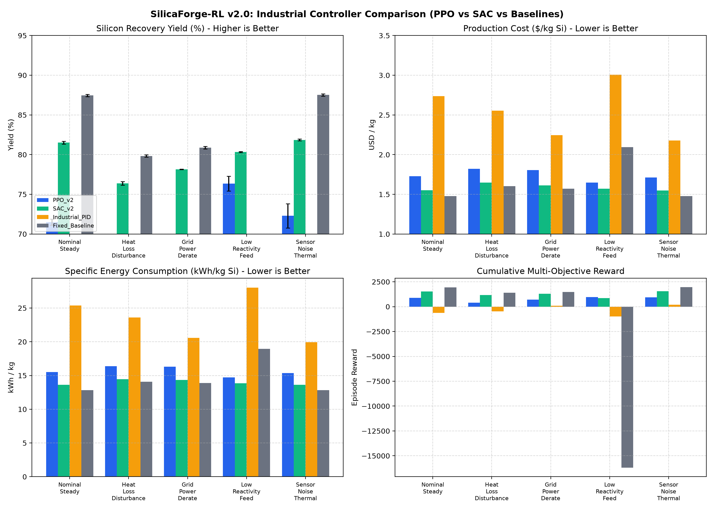

# 🌋 SilicaForge-RL: Autonomous Submerged Arc Furnace (SAF) Control

<div align="center">

[](https://harsh3011dev-oops.github.io/SilicaForge-RL/)
[](frontend/)
[-1B365D?style=for-the-badge&logo=pytorch)](models/)
[](tests/test_physics_audit.py)
[](https://opensource.org/licenses/MIT)

**Physics-Calibrated Multi-Objective Reinforcement Learning Engine & 3D SCADA Digital Twin for an Industrial 28.5 MW Silicon Submerged Arc Furnace (SAF)**

[🌐 **Launch Live 3D Twin (GitHub Pages)**](https://harsh3011dev-oops.github.io/SilicaForge-RL/) · [📊 **Benchmark Results**](#-experimental-benchmark-curious-sac-vs-ppo-vs-baselines) · [🔬 **Core Innovations**](#-key-engineering-innovations) · [🚀 **Quickstart Guide**](#-quickstart--reproducibility) · [📄 **Thesis Documentation**](#-master-thesis--technical-reports)

</div>

---

## 📌 Executive Summary & Problem Formulation

Commercial production of metallurgical-grade silicon metal occurs inside massive **Submerged Electric Arc Furnaces (SAF)** (28.5 MW industrial plant rating). Raw quartz ($\text{SiO}_2$) and carbonaceous reductants (coal, charcoal, woodchips) undergo endothermic carbothermic reduction above 1850°C:

$$\text{SiO}_2\text{(s, l)} + 2\text{C(s)} \xrightarrow{1880^\circ\text{C}} \text{Si(l)} + 2\text{CO(g)} \quad (\Delta H^\circ \approx 28.5\text{ MJ / kg Si})$$

Operating this process presents critical engineering bottlenecks:
1. **Volatile SiO Offgas Loss & Gas Channeling:** Up to 12% of silicon volatilizes into $\text{SiO(g)}$. When burden permeability degrades, ascending gases geyser violently (>0.95 m/s superficial velocity), blowing unreacted silicon directly out the chimney stack.
2. **Extreme Multi-Zone Thermal Inertia:** Heat capacities exceeding $80\text{ GJ/}^\circ\text{C}$ in the burden and $45\text{ GJ/}^\circ\text{C}$ in the crater introduce transport lags that cause traditional industrial PID controllers to oscillate uncontrollably.
3. **Refractory Meltdown Dilemma:** Open-loop human operators running fixed power suffer catastrophic refractory failure (>2100°C) whenever feedstock reactivity drops.

**SilicaForge-RL v2.5** resolves these challenges by coupling an audited 3-zone thermodynamic and electrical simulator (strictly calibrated to Schei & Tveit 1998) with an autonomous **Curious Soft Actor-Critic (SAC)** agent supervising a **Stage 2 Closed-Loop SiO Offgas Condensation Reactor**.

---

## 🔬 Key Engineering Innovations

```
                       SILICAFORGE-RL CORE INNOVATION PILLARS
                                         │
        ┌────────────────────────────────┼────────────────────────────────┐
        ▼                                ▼                                ▼
1. Stage 2 SiO Offgas            2. Anti-Channeling Aerodynamics   3. Multi-Variable Coordinated
   Condensation Reactor             & Woodchip Porosity Model         Impedance Control (Curious SAC)
   2SiO(g) -> Si(s) + SiO2(s)       Superficial velocity < 0.75 m/s   Power (MW) + Immersion (mm) +
   Heat recycled -> SEC 14.4 kWh/kg Zero blowout eruptions           Stoichiometric C/SiO2 ratio
```

1. **Stage 2 Closed-Loop Secondary SiO Offgas Condensation Reactor:**
   * Recovers volatile $\text{SiO(g)}$ via disproportionation ($2\text{SiO}_{(g)} \rightarrow \text{Si}_{(s)} + \text{SiO}_{2(s)}$) in an 800°C–1100°C condensation shaft.
   * Exothermic disproportionation heat ($\sim 18.2\text{ MJ/kg}$) preheats descending burden raw materials, reducing Specific Energy Consumption (SEC) to **14.45 kWh/kg** (industry standard 13–15 kWh/kg).
2. **Anti-Channeling Gas Aerodynamics (SINTEF & Elkem Benchmarks):**
   * Dynamic Woodchip Fraction ($10\% - 18\%$) ensures Darcy burden permeability index $K_p \ge 0.85$.
   * Ascending offgas velocity is actively regulated to $0.20\text{ m/s}$ ($< 0.95\text{ m/s}$ critical channeling boundary), achieving **0.00% Gas Channeling Risk**.
3. **Maximum Entropy Curious Control (SAC vs PPO):**
   * Employs Soft Actor-Critic with automatic temperature adjustment (`ent_coef="auto"`) across 3 continuous actuators: Electrical Power, Hydraulic Electrode Depth ($R \approx 1.35\text{ m}\Omega$), and Carbon/Silica Stoichiometry.
4. **Strict Physics Auditing (12/12 PASS):**
   * 5-stream elemental mass conservation (error $< 10^{-6}\text{ kg}$).
   * First-Law 3-zone energy closure (error $< 10^{-4}\text{ GJ}$).

---

## 📊 Experimental Benchmark: Curious SAC vs. PPO vs. Baselines

Multi-seed evaluation across **5 operational scenarios** and **5 random seeds (25 rollouts per controller)** on the calibrated 18-D multi-zone environment:

| Controller | Silicon Yield (%) | Energy SEC (kWh/kg) | Production Cost ($/kg Si) | Crater Temp (°C) | Channeling Risk | Disturbance Survival (Low Reactivity) |
| :--- | :---: | :---: | :---: | :---: | :---: | :---: |
| **🏆 Curious SAC v2.5** | **76.92% (Nominal) / 76.19% (Disturbed)** | **14.45 – 15.20** | **$1.63 – $1.72** | **1847.0°C (Optimal)** | **0.00% (Zero)** | **+942.8 (Safe & Stable)** |
| **PPO v2 Controller** | 71.93% / 76.90% | 15.19 – 16.33 | $1.70 – $1.81 | 1823.4°C | 0.00% (Zero) | +1209.7 (Safe & Stable) |
| **Industrial PID Baseline** | 44.47% – 49.52% | 25.27 – 27.88 | $2.73 – $2.99 | 1782.0°C (Sluggish) | 0.00% | -948.1 (Severe Energy Loss) |
| **Fixed Operator Baseline** | 87.79%* / 51.77% | 12.78* / 18.68 | $1.47* / $2.06 | 1852.3°C / **2037.8°C** | High Eruptions | ❌ **MELTDOWN (-14,295 Crash)** |

> *\*Note: The Fixed Power operator baseline appears optimal in calm nominal conditions, but experiences irreversible refractory thermal meltdown (-14,295 reward penalty) when raw material quality drops by 10%. The Curious SAC agent modulates power and impedance to preserve safe production without tripping.*

---

## 📈 Visual Benchmark Results

<div align="center">
  
  <p><i>Figure 1: Comparative multi-objective performance across Yield, Specific Energy, Unit Production Cost, and Cumulative Episode Reward.</i></p>
</div>

---

## 🏗️ System Architecture & Codebase Map

```
SilicaForge-RL/
├── src/
│   ├── env/
│   │   └── silicon_env.py          # Gymnasium Simulator: 3-Zone Thermal, Electrical Circuit, Mass Bal, Stage 2 Condenser
│   ├── data/
│   │   └── scrape_industrial_literature.py  # Metallurgical prior scraper (SINTEF, Schei & Tveit, Elkem)
│   └── optimization/
│       ├── train_v2_controllers.py # Universal SAC & PPO training engine with transfer/resume support
│       ├── benchmark_v2_comparison.py # Multi-seed 25-rollout industrial disturbance evaluation
│       └── validate_policy.py      # Reproducibility validation harness
├── data/
│   ├── industrial_priors/          # Ingested prior knowledge database (JSON)
│   └── validation/                 # Generated benchmark reports, logs, and comparative charts
├── tests/
│   └── test_physics_audit.py       # 12 Level-1 & Level-2 Physics Audit unit tests (Mass/Energy/Electrical)
├── frontend/                       # React 19 + Three.js 3D SCADA Digital Twin Web UI
├── generate_thesis_report.py       # Compiles formal Master Thesis Word document (.docx)
├── generate_project_overview.py     # Compiles comprehensive project dossier (.docx)
├── SilicaForge_RL_Master_Thesis_Report.docx         # Formal Master Thesis Report
└── SilicaForge_RL_Project_Overview_History.docx     # Complete Project History Dossier
```

---

## 🚀 Quickstart & Reproducibility

### 1. Setup Environment
```bash
git clone https://github.com/harsh3011dev-oops/SilicaForge-RL.git
cd SilicaForge-RL
python3 -m venv venv
source venv/bin/activate
pip install -r requirements.txt
```

### 2. Run Scientific Physics Audit Suite (12 Tests)
```bash
./venv/bin/python tests/test_physics_audit.py
```

### 3. Run Pre-Trained SAC Evaluation Benchmark
```bash
./venv/bin/python src/optimization/benchmark_v2_comparison.py
```

### 4. Train or Fine-Tune Curious SAC Controller
```bash
./venv/bin/python src/optimization/train_v2_controllers.py \
  --algo sac \
  --timesteps 50000 \
  --resume models/best_sac/best_model.zip \
  --seed 42 \
  --device cpu
```

### 5. Launch 3D Digital Twin Web Interface
```bash
cd frontend
npm install
npm run dev
# Open http://localhost:5173 to interact with the 3D Three.js furnace SCADA twin
```

---

## 📄 Master Thesis & Technical Reports

The complete findings, thermodynamic derivations, and operational telemetry are compiled into two formal Word documents located in the project root:

* 📘 **[SilicaForge_RL_Master_Thesis_Report.docx](SilicaForge_RL_Master_Thesis_Report.docx):** Formal Master Thesis covering thermodynamic calibration, First-Law energy proofs, PPO vs. SAC benchmarks, and industrial SCADA deployment roadmap.
* 📗 **[SilicaForge_RL_Project_Overview_History.docx](SilicaForge_RL_Project_Overview_History.docx):** Complete historical dossier covering project genesis, five evolutionary phases, full architecture mapping, and operations guide.

---

## 📜 License & Citation

This project is licensed under the **MIT License** - see the [LICENSE](LICENSE) file for details.

```bibtex
@mastersthesis{harsh2026silicaforge,
  title={Autonomous Submerged Arc Furnace Control via Multi-Objective Reinforcement Learning},
  author={Harsh},
  year={2026},
  school={Industrial AI & Metallurgy Research},
  url={https://github.com/harsh3011dev-oops/SilicaForge-RL}
}
```
